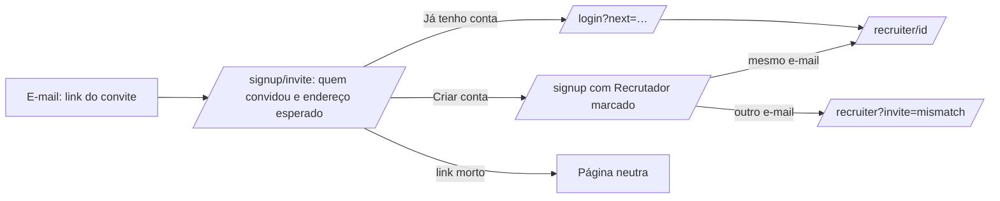

# Jornada: aceitar o convite de um candidato

```yaml
journey:
  id: J-accept-recruiter-invite
  name: Recrutadora recebe o convite por e-mail, cria a conta com o endereço convidado e chega ao candidato
  priority: P1
  value_statement: O candidato dá acesso a quem ainda não tem conta sem pedir nada ao admin, e o acesso só alcança o endereço que ele digitou — um link encaminhado a outra pessoa não abre nada
  personas: [Recrutadora convidada]
  entry_points:
    - url: /signup/invite?token=…
      origin: link do e-mail de convite
  actions:
    - step: 1
      verb: Abrir o link do e-mail sem estar logada
      expected_observable: A página diz quem convidou e mostra o endereço esperado mascarado (primeira letra e domínio), com "Criar conta de recrutador" e "Já tenho conta"
    - step: 2
      verb: Clicar em "Criar conta de recrutador"
      expected_observable: /signup com Recrutador marcado e a linha "Convidado por <nome>. Endereço esperado <mascarado>", também depois de voltar do Google ou do LinkedIn
    - step: 3
      verb: Cadastrar-se com o e-mail convidado (Google, LinkedIn ou e-mail e código)
      expected_observable: Cai na página do candidato em /recruiter/<id>; chega o e-mail "<nome> deu acesso a você no Master Jobs"
    - step: 4
      verb: Já com conta de recrutador, abrir o link e escolher "Já tenho conta"
      expected_observable: Depois de entrar, volta ao link e segue direto para a página do candidato; com sessão do e-mail convidado, "Aceitar e abrir" conclui num clique
    - step: 5
      verb: Recarregar a página do candidato e, no candidato, abrir Minha conta
      expected_observable: O acesso continua; a lista do candidato mostra a recrutadora "Ativo" e o histórico "Convite aceito por <e-mail>"
  goal:
    observable: A conta com o e-mail convidado vê o candidato; nenhuma outra conta ganha acesso pelo mesmo link
    side_effects: [auth_user, recruiter_invite accepted, recruiter_grant active com invite_id, recruiter_access_event invite_accepted e grant_created, e-mail de acesso concedido]
  true_end_state: Depois do refresh, /recruiter lista o candidato e o link do convite, aberto de novo, leva à página dele (ou dá a página neutra para quem não o aceitou)
  exit:
    natural: Ler o funil e o currículo do candidato
  abandonment:
    - at_step: 2
      how: Fecha o cadastro no meio
      resume: O link continua valendo até vencer; nada foi criado
    - at_step: 3
      how: Cadastra-se com outro endereço
      resume: A conta nasce, mas /recruiter avisa que o convite foi para outro e-mail e o candidato não aparece; o convite segue pendente para o endereço certo
    - at_step: 1
      how: O link venceu, foi reenviado, cancelado ou já usado
      resume: A mesma página "Este convite não vale mais", sem dizer qual; pedir outro ao candidato
  crosses: [auth policy, signup, social sign-in, recruiter access store, advisory lock, mailer, i18n, responsive shell]
```



- **Entrada:** e-mail de convite enviado pelo candidato; sem sessão ou com a
  conta de recrutador do endereço convidado.
- **Estado final verdadeiro:** concessão ativa da conta com o e-mail convidado,
  com a data de fim que o candidato escolheu no convite.
- **Saída:** a página do candidato no espaço de recrutador.
- **Abandono:** nada nasce antes do cadastro concluir; o cookie do convite
  morre com o convite.
