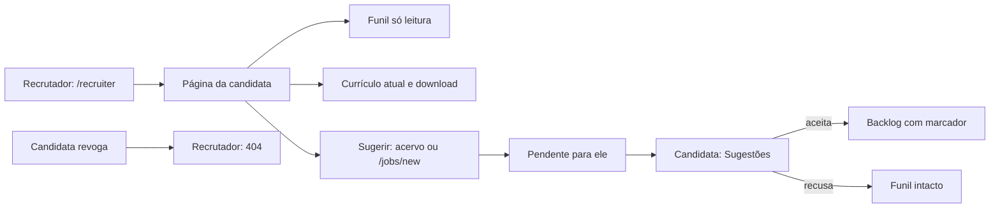

# Jornada: sugerir uma vaga a quem deu acesso, e a pessoa decidir

```yaml
journey:
  id: J-suggest-job-to-candidate
  name: O recrutador com acesso lê o funil e o currículo e sugere vagas; só a candidata aceita ou recusa
  priority: P1
  value_statement: Quem acompanha a busca traz a vaga que o acervo não tem, e a decisão de entrar no funil continua sendo só da pessoa (regra 2)
  personas: [Recrutadora convidada, Andreus em triagem noturna, Andreus no celular]
  entry_points:
    - url: /recruiter
      origin: nav
    - url: /suggestions
      origin: nav
  actions:
    - step: 1
      verb: Abrir /recruiter e escolher a candidata
      expected_observable: Cada candidato com "Acesso desde", o fim se houver e as sugestões pendentes; o nome dela está no título da aba e na página, como texto
    - step: 2
      verb: Ler o funil e abrir "Ver currículo"
      expected_observable: Contagem por estágio e linhas sem nenhum controle de escrita; o currículo atual aparece e baixa como <nome>-cv.md; nenhuma versão antiga
    - step: 3
      verb: Sugerir uma vaga do acervo com nota, ou cadastrar uma nova em /jobs/new
      expected_observable: A sugestão aparece como "Pendente" na lista do recrutador; nota acima de 500 caracteres recusa no campo e fica escrita; a mesma vaga de novo diz "Você já sugeriu esta vaga"
    - step: 4
      verb: Como candidata, abrir "Sugestões" pela navegação
      expected_observable: A contagem da navegação bate com as pendentes; cada item mostra vaga, empresa, nota, quem sugeriu e a nota dele como texto
    - step: 5
      verb: Aceitar uma sugestão e recusar outra
      expected_observable: A aceita entra no funil em Backlog com "sugerida por recrutador"; a recusada não muda o funil; o recrutador vê "Aceita em" e "Recusada em"
    - step: 6
      verb: Revogar o acesso do recrutador em Minha conta
      expected_observable: A página, o currículo e sugerir da candidata dão 404 para ele na próxima navegação; as sugestões dele continuam com ela, marcadas "acesso encerrado", e ainda decidíveis
  goal:
    observable: A vaga sugerida só chega ao funil pelo aceite da candidata, e o recrutador só lê o que o escopo permite
    side_effects: [recruiter_suggestion, recruiter_suggestion_by, recruiter_access_event, application só no aceite, e-mail de sugestões no máximo um por hora]
  true_end_state: Depois de recarregar, o funil, a lista de sugestões e a do recrutador batem com o que foi decidido
  exit:
    natural: Seguir a vaga aceita no funil
  abandonment:
    - at_step: 3
      how: Vinte sugestões à mesma pessoa em 24 h
      resume: A recusa diz a hora em que dá para sugerir de novo
    - at_step: 4
      how: Sessão emprestada por um admin
      resume: As sugestões aparecem sem Aceitar nem Recusar; decidir é só da pessoa
  crosses: [auth policy, advisory lock, recruiter access predicate, funnel write path, mailer, sweep, i18n, responsive shell]
```


